# Vimbai Farms App

**A phone app and control system for a commercial button mushroom farm in Harare, Zimbabwe.**
Built with Google Apps Script, Google Sheets and plain JavaScript. Designed for farm staff on low-end Android phones with patchy signal.

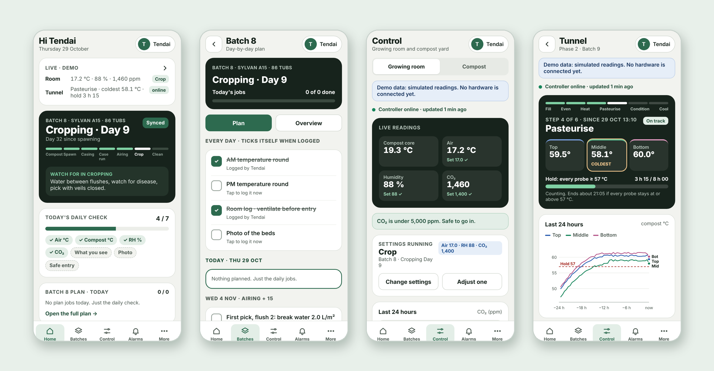

> 🔒 **The source code is in a private repository.** Access is available on request; open an issue here or contact me through my GitHub profile.
> Screenshots show sample data and sample names.

---

## The problem

Button mushrooms (*Agaricus bisporus*) are unforgiving. Compost a degree too hot, casing too wet, or CO₂ too high for a few days, and a batch loses most of its yield. On this farm, one batch produced **324 kg** and the next only **49.2 kg**, and nobody could say exactly why: readings were on paper, incomplete, or never taken.

## The solution

An app the growing-room staff actually use, at the bench, on their own phones:

1. **Capture every reading** where it happens: temperature rounds on 24 sentinel tubs, room readings, watering, picks, problems and chemicals, with photos.
2. **Check it against the batch's stage** (spawn run, case run, airing, cropping) and the targets for that stage.
3. **Act the same day**: alarms raised on the server every 15 minutes and emailed when red, a day-by-day crop plan, and direct control of the room and compost-yard equipment.

## Highlights

| | |
|---|---|
| **Offline-first logging** | Entries queue on the phone and send when signal returns, because growing rooms have poor coverage. |
| **Crop plan that re-anchors itself** | Generated from the spawn date, then shifted to the real casing and airing dates once the readiness checks pass. |
| **Alarm engine** | Compost ≥ 26.7 °C, missed temperature rounds, CO₂ over 5,000 ppm with no ventilation, water before casing, chemicals, overdue jobs, silent controller, tunnel probe faults. Alarms clear themselves when the fix is logged. |
| **Equipment control** | Live readings vs. setpoints, ventilate for entry, temporary adjustments that revert by themselves, airing in timed steps. Commands are queued, time-boxed and acknowledged by the controller. |
| **Pasteurisation timer** | Counts only while *every* tunnel probe is above the hold line, so the coldest spot decides. |
| **Safety rails** | Settings that don't match the batch's stage are refused unless a reason is logged; roles limit who can change what. |
| **Testable without Google** | The Apps Script server code runs unchanged in Node against an in-memory mock; a scenario replays a full batch for the demo, tests and these screenshots. |

## Screens

| First run | Home | Batch plan | Growing room |
|---|---|---|---|
| 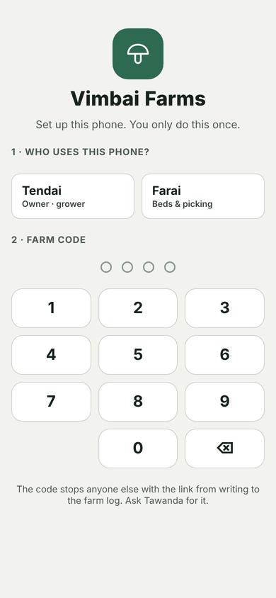 | 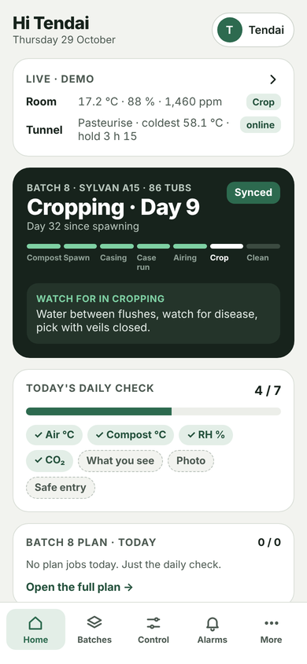 | 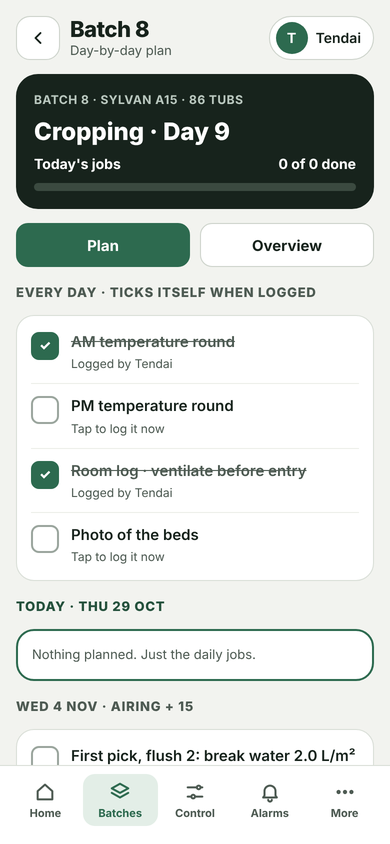 | 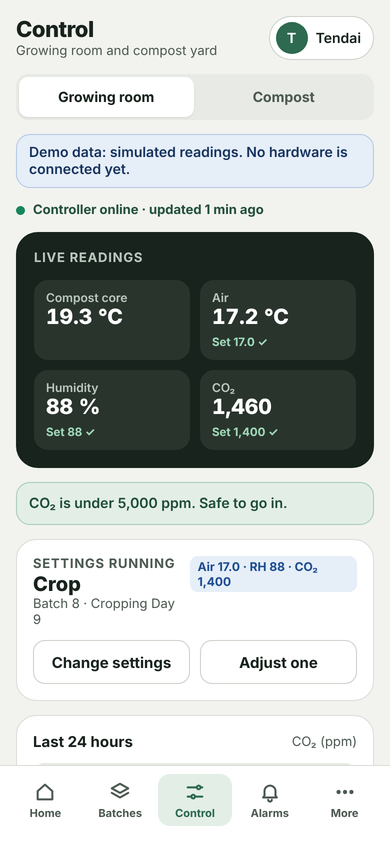 |

| Tunnel (Phase 2) | Alarm rules | Programs | Trends |
|---|---|---|---|
| 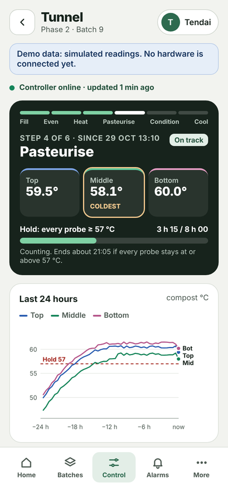 | 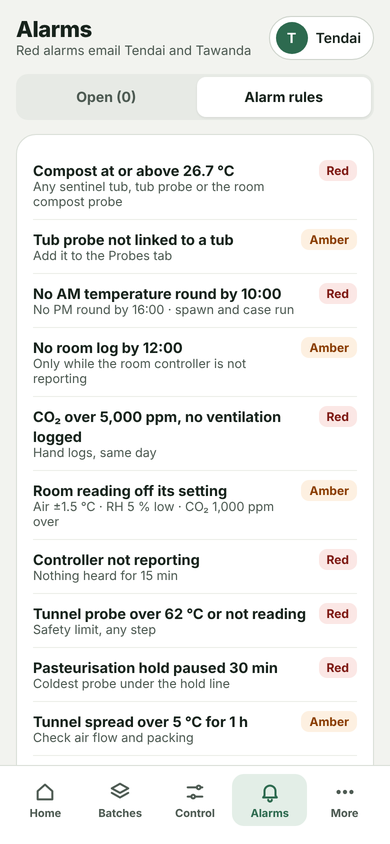 | 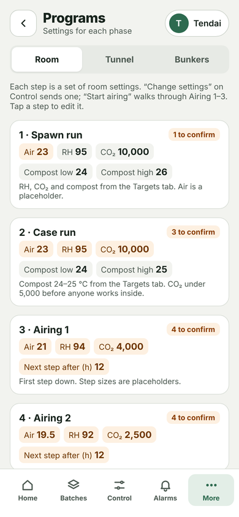 | 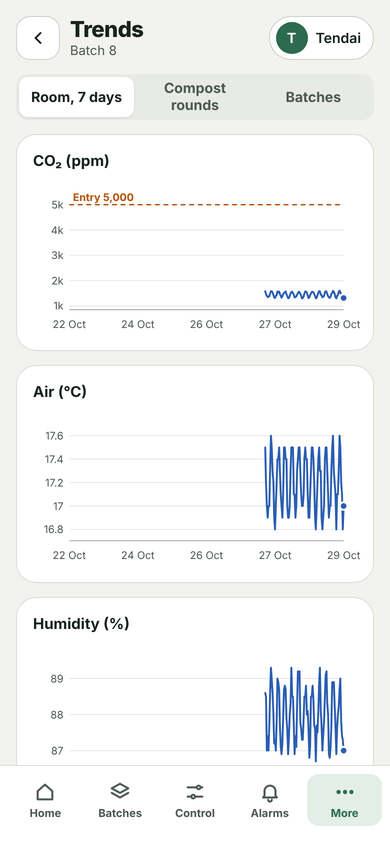 |

| Temperature round | Harvest | Calendar |
|---|---|---|
| 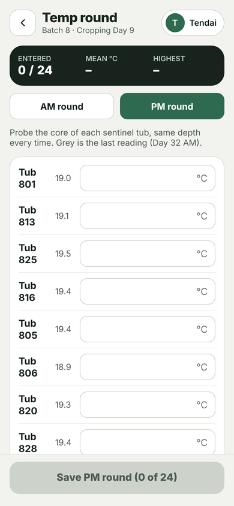 | 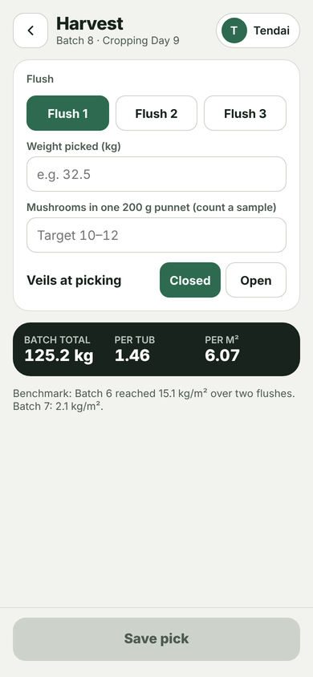 | 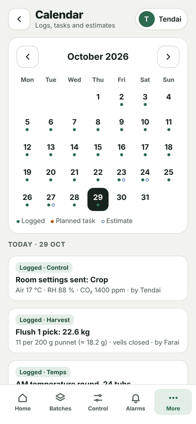 |

## Architecture

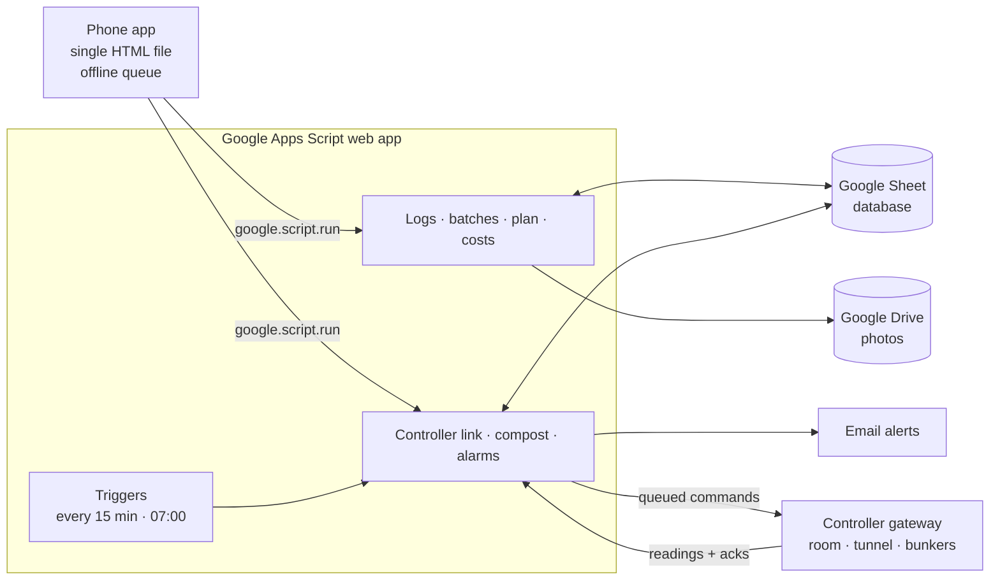

**Why these choices:** no server to run or pay for, the farm already lived in Google Sheets, the owner can read the data without the app, and a single framework-free HTML file loads fast on cheap phones.

## Tech

Google Apps Script (V8) · Google Sheets · Google Drive · vanilla JavaScript, HTML and CSS · Node.js (tooling and tests) · Playwright (screenshots) · clasp

## My role

Sole designer and developer: requirements with the farm team, UX for non-technical staff, server and data model, alarm rules, controller gateway spec, local tooling and tests.

## Status

Deployed on the farm. Controller hardware integration is specified; the control screens run on simulated readings until it's installed.
